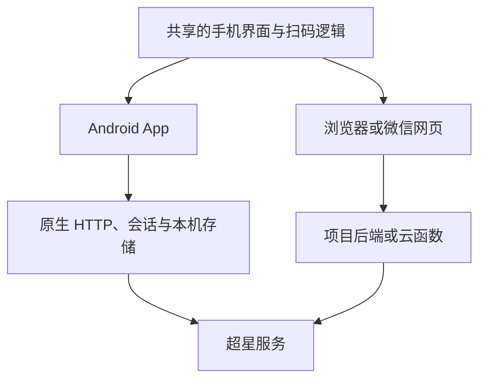

# 架构与数据流

## 第一版选择

第一版采用 Android App，网络请求和会话管理放在手机本机，不购买云服务器。网页加后端仅作为后续可选路线。

0.1 实验版已实现 Android 原生界面，官方页面运行在独立 WebView 中，没有暴露 JavaScript-to-native 桥接。下图的共享网页界面为后续可选设计，并非当前代码的实现。

## 两条实现路线

App 路线可以不运营自己的服务器。网页路线的主要问题在浏览器网络权限和会话处理，不在于手机的计算能力。

## 可以放在手机上的工作

- 相机取景、二维码解析、相册二维码识别。
- 图片裁剪、缩放和压缩。
- 资料列表、操作历史、活动与二维码匹配。
- App 内通过原生 HTTP 发送请求并管理会话。
- 在合适的本机存储中保存用户自己的资料和登录状态。

资料留在本机不等于数据从不离开手机。访问官方服务时，必要的登录信息、照片或文件标识仍可能需要提交给超星。

## 纯 GitHub Pages 的边界

GitHub Pages 托管静态 HTML、CSS 和 JavaScript。它不提供本项目运行时所需的 API 服务器。

浏览器是否能直接访问某个超星接口，取决于对方接口的 CORS 响应、凭据规则和浏览器 Cookie 策略，必须逐接口核实。不能仅凭接口地址能打开，就判断完整登录与签到流程能在网页中运行。

将网页安装为 PWA、加入 Service Worker、改用 WebAssembly 或把请求设为 no-cors，都不会赋予页面任意跨域读取与会话管理能力。no-cors 产生的不透明响应也无法用于可靠读取登录和签到结果。

可行的补充方式包括原生 App 网络层、浏览器扩展或用户自己运行的本地服务。这些方案需要额外组件，不再是用户仅打开一个静态网址即可使用。

## App 应包含什么

建议共享界面代码，将网络、扫码、存储抽象成独立适配层。原生 HTTP 负责实际请求；会话按账号隔离；登录状态清理与退出流程应同步清理原生 Cookie 和本机资料引用。

不要将账号密码或登录 Cookie 放进分享链接、二维码、GitHub 仓库、构建产物的示例配置或公开日志。一般不必为了便利而长期保存账号密码。

App 的原生网络能力解决的是浏览器限制，不会自动满足超星的活动、设备和人脸校验要求。相关接口是否接受请求，仍需要实际验证。

## 网页后端应负责什么

- 登录会话保持与过期处理。
- 访问受支持的超星接口，并将所需结果返回前端。
- 必要的照片上传与官方文件标识关联。
- 请求限流、超时处理和明确的错误结果。

若后端提供接口转发，应固定允许访问的官方目标和业务操作，不做允许任意地址的公开代理。日志中不记录密码、Cookie、完整照片或有效凭据。

只提供短时交互操作时，后端可保持轻量。只有确实需要同步账号、保存历史或后台任务时，再引入数据库和任务队列。

## 云主机与云函数

轻量云主机便于集中管理会话、上传和持续任务，代价是需要维护运行环境。2 核、2GB 内存是原型和小范围轻量业务的起步估算，不代表确定的并发承诺。

云函数可以按调用执行短请求，不必购买长期运行的虚拟机，但仍要处理 Cookie、会话持久化、照片上传、冷启动、时限和出站网络。若加入长期监控或密集轮询，需要另行设计。

## 结果与验证

界面应区分：

1. 本机已保存照片或文件 ID。
2. 官方本次人脸验证已通过。
3. 官方签到记录已确认成功。

本机拥有一个文件 ID，不能直接显示为本次验证成功。发布前应验证正常登录、会话过期、二维码过期或活动不匹配、人脸失败，以及官方结果查询。

## 依据

- [GitHub Pages](https://docs.github.com/en/pages/getting-started-with-github-pages/what-is-github-pages)
- [CORS 与凭据](https://developer.mozilla.org/en-US/docs/Web/HTTP/Guides/CORS)
- [原生 HTTP API](https://capacitorjs.com/docs/apis/http)

